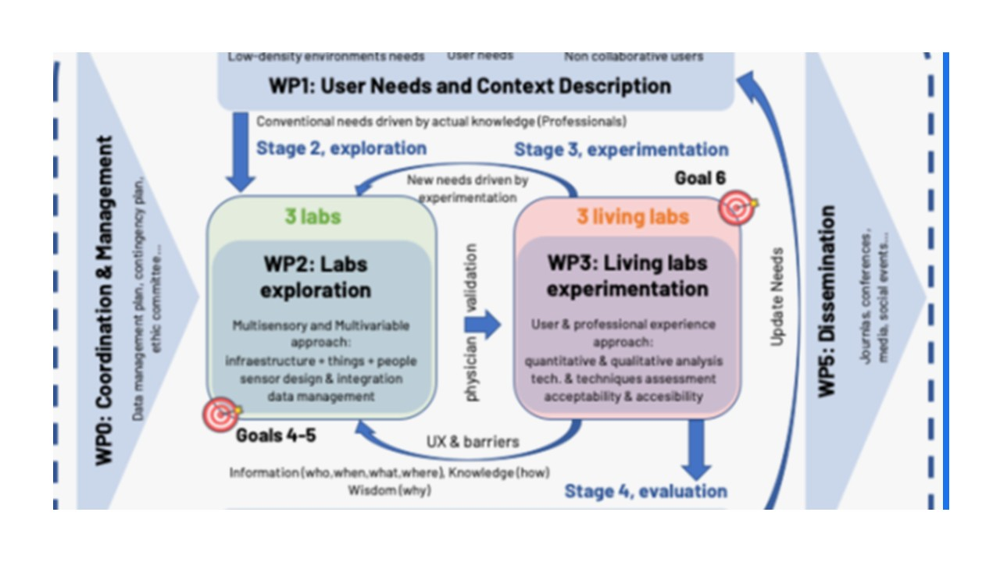

 

The purpose of the <b>AGINPLACE</b> project is to promote the development of an innovative environment that allows responding to the great challenges posed by non-collaborative people with mental health disorders so they can live autonomously in their homes for longer and with quality of life, delaying or even avoiding their institutionalization. The main barrier is that they are not aware about their disease and dysfunctionality, and consequently reject help without any awareness about their risks and limitations. This target group is specially challenging as they do not tend to collaborate nor to trust almost on nobody or anything. It is the case of mental disorders such as frontal dementia or psychotic disorders in dementia.

The main objective of AGINPLACE is to <b>promote the individual and social well-being of people living with mental health disorders aging in place, autonomously, in their own houses</b>, avoiding or delaying their institutionalization. In order to achieve this aim AGINPLACE will take special care to involve this target group and related stakeholders by setting up an open innovation ecosystem based on systematic user co-creation approaches to fill the gap between techbased solutions and the user engagement. Based on the requirements set by this target group and their context, AGINPLACE will advance in models, sensors’ distribution, signal design and processing algorithms to enhance the detection of observables. It will incorporate AI engines to support decision-making through analysis of patient data, building computer systems that can learn patterns from a training data set, and apply those patterns to new data with the prospect of enhancing decision-making. Finally, AGINPLACE will provide a thorough analysis on the safety, efficacy, acceptability, feasibility, and cost-effectiveness of digital technology to provide evidence of digital health interventions.

<b>Based on the project hypothesis and the state of the art, AGINPLACE has set the following general objectives:</b>

<ul>
<li><b>O1.</b> To fully understand the unmet needs of people with cognitive and mental disorders, especially of those non-collaboratives and living in rural areas.</li>
<li><b>O2.</b> To address the user engagement and tech acceptability during the implementation of the digital tools among the different living labs, also considering their families, caregivers, and professionals.</li>
<li><b>O3.</b> To develop digital technology and its applications under the legal, ethical, and regulatory frameworks to establish the baseline over which the next stages will be built.</li>
<li><b>O4.</b> To develop and deploy user location and activity detection sensory prototypes, with special emphasis in the design of the physical layer, signal processing techniques, and device-free or passive strategies.</li>
<li><b>O5.</b> To develop sound-based systems able to work at home for the early and continued analysis of aging related health conditions such as activity monitoring, lower urinary tract problems and sleep quality.</li>
<li><b>O6.</b> To integrate multi-modalities (such as the speech and the user behavior pattern, cameras will not be included because most users used refuse them) in an AI based system to supervise the user’s emotional states introducing multimodal feature fusion level, and decision level fusion.</li>
<li><b>O7.</b> To analyze the feasibility, implementation and approach of efficacy and costeffectiveness of both real-time and predictive analytics mental health applications.</li>

The fiGure below shows the mapping of the six WPs into the four proposed stages and through the two approaches: testing innovative technologies and prototypes in three labs, and those validated by the stakeholders adding AI techniques with long-term follow-up data in three living labs.  
</ul>

 

